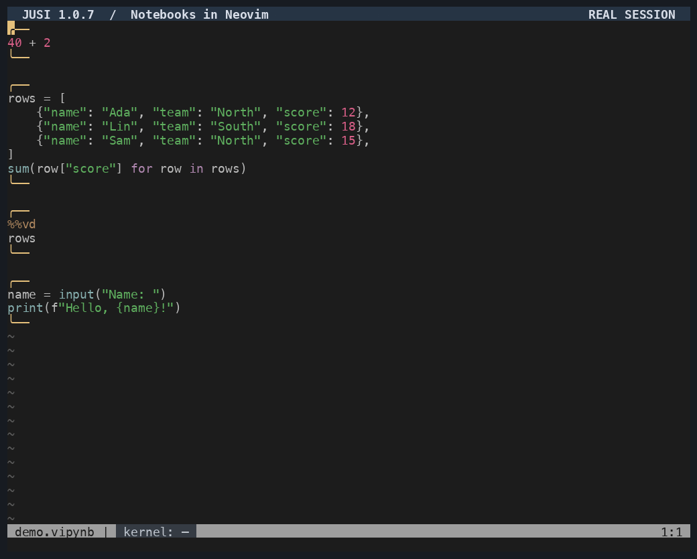

# Jusi

Jusi позволяет работать с ядрами Jupyter и интерактивными инструментами в Neovim.
Редактируйте текстовые блокноты, выполняйте ячейки и работайте с их выводом
в отдельных окнах Neovim. Редактирование, навигация и история доступны
даже без запущенного ядра.



- Подсветка синтаксиса, отступы и автодополнение отдельно для каждой ячейки.
- Интерактивные терминальные клиенты, включая встроенную интеграцию с VisiData.
- История запросов к клиенту, закрепление вывода и навигация с клавиатуры.
- Локальные и удалённые ядра через Python-сервис на стороне целевого окружения.
- Копирование, открытие и просмотр различий в Neovim по запросу плагинов.

## Установка

Установите бэкенд в своё окружение Python 3.9+:

```sh
pip install jusi
# Или установите вместе с VisiData:
pip install 'jusi[vd]'
```

Установите фронтенд из репозитория `ssh://fixmerepo/Python/Jusi.git`
через менеджер плагинов Neovim с явным URL или используйте стандартный
каталог пакетов:

```sh
git clone ssh://fixmerepo/Python/Jusi.git \
  "${XDG_DATA_HOME:-$HOME/.local/share}/nvim/site/pack/jusi/start/jusi"
```

Фронтенду нужны Neovim 0.11+, curl и POSIX-совместимая оболочка. Используйте
одинаковые версии бэкенда и фронтенда; команда `jusi` должна быть доступна
в PATH Neovim. Настройка и обновление описаны в [руководстве по установке](docs/1.0/installation.md).

## Готовые плагины

Для Jusi доступны готовые плагины оболочки, PostgreSQL, ClickHouse и GigaCode:

| Плагин | Возможности | Установка |
| --- | --- | --- |
| Shell | Интерактивная оболочка через `%%shell` | `pip install jusi-shell` |
| PostgreSQL | SQL-запросы и просмотр результатов в VisiData | `pip install jusi-postgres` |
| ClickHouse | SQL-запросы и просмотр результатов в VisiData | `pip install jusi-clickhouse` |
| GigaCode | Работа с агентом GigaCode через `%%acp` | `pip install jusi-gigacode` |

Устанавливайте плагины в Python-окружение сервиса и ядра на целевом узле.
После установки перезапустите блокнот командой `:JusiRestart`.
SQL-плагинам нужна настройка подключения, а GigaCode — установленная команда
`gigacode` на целевом узле. Подробнее — в [руководстве по готовым плагинам](docs/1.0/available-plugins.md).

## Первый блокнот

Сохраните этот текст в `example.vipynb` и откройте файл в Neovim:

```text
╭──
40 + 2
╰──
```

Выполните `:JusiStart local`, затем `:JusiExecute`, находясь внутри ячейки.
Результат откроется в отдельном окне. Нажмите Ctrl-\ дважды, чтобы переключить
фокус между ячейкой и её выводом. Команда `:JusiStop` закрывает ядро
и запущенный для него сервис.

Пробел переключает режим ячеек: Enter отправляет содержимое, `j`/`k` перемещают
между ячейками, `B` создаёт ячейку ниже, а `S` закрепляет вывод, чтобы он
сохранялся при последующих выполнениях.
Все команды, ввод, история и статусы описаны в [руководстве пользователя](docs/1.0/usage.md).

## Блокноты Jupyter

```sh
jusi import-ipynb notebook.ipynb
jusi export-ipynb notebook.vipynb -o exported.ipynb
```

При импорте исходный текст ячеек кода, Markdown и raw сохраняется в обычных
ячейках Jusi. При экспорте создаются ячейки кода. Вывод и история запросов
не включаются. Подробнее — в [руководстве по преобразованию](docs/1.0/notebook-conversion.md).

## Дополнительные материалы

- [Локальные и удалённые целевые окружения](docs/1.0/architecture/target-start-stop.md)
- [VisiData: просмотр данных, копирование значений и открытие содержимого](docs/1.0/architecture/bundled-vd.md)
- [Полезные команды, включая JShell](docs/1.0/useful-commands.md)
- [Настройка бэкенда](docs/1.0/configuration.md)
- [Навыки для разработки плагинов](docs/1.0/skills.md): установка через `jusi install-skills`
- [Участие в разработке и тесты](CONTRIBUTING.md)
- [История изменений](CHANGELOG.md)

Jusi 1.0 требует Neovim; Vim и старый синтаксис блокнотов Jusi не поддерживаются.
[Архитектура](docs/1.0/architecture/overview.md),
[модель состояний](docs/1.0/state-model.md) и
[владение компонентами](docs/1.0/ownership.md) документируются отдельно
от пользовательских руководств.
